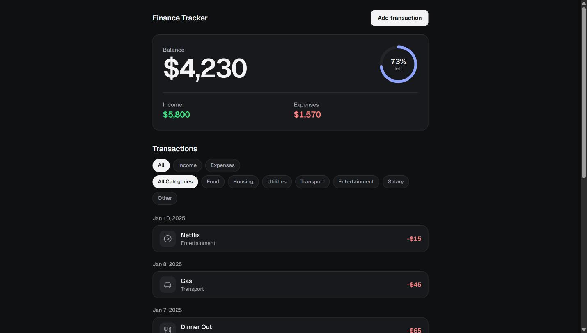
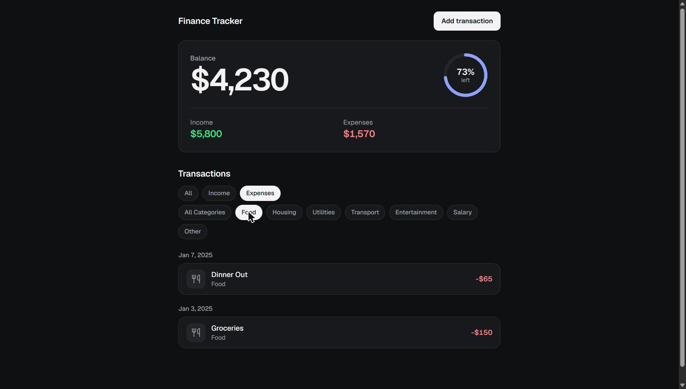
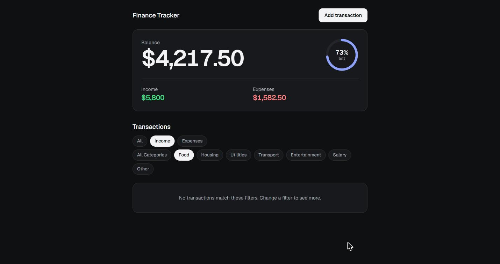
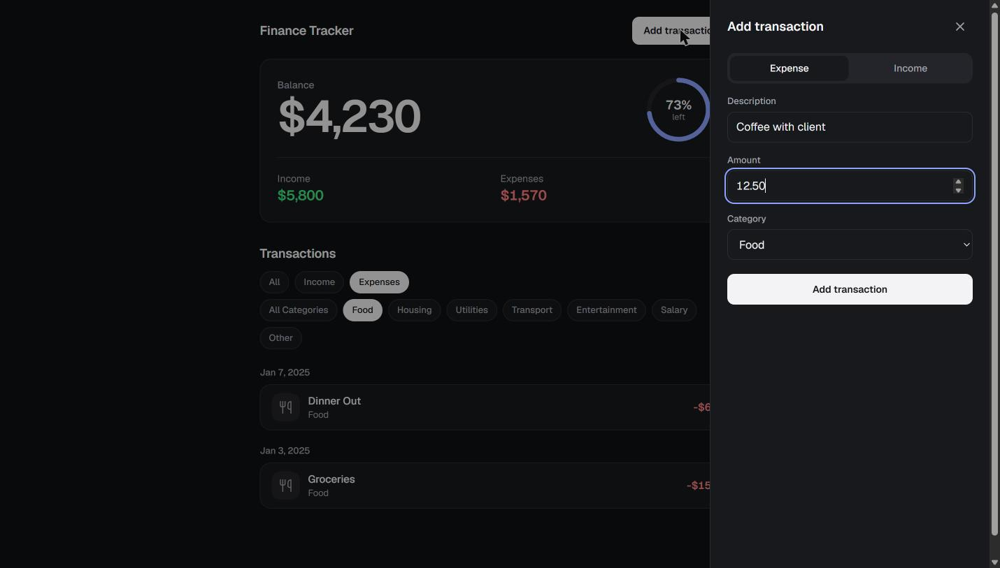
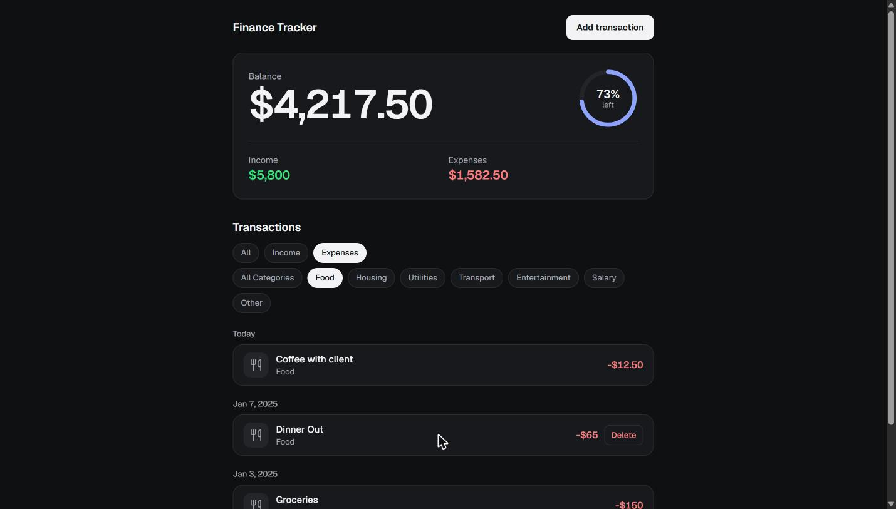
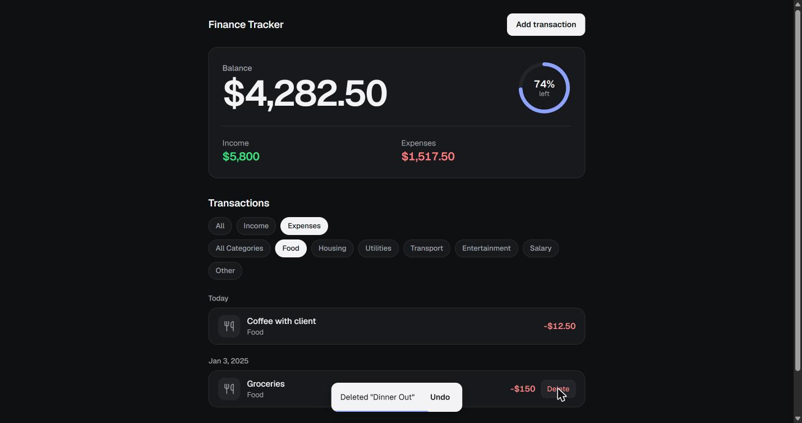

# Finance Tracker

A personal expense tracker built with React 19 and Vite. Record income and expenses, see your balance at a glance, and filter your history by type or category. The code is in [`expense-tracker-starter/`](expense-tracker-starter/).

The app runs entirely in the browser, with no backend or account. **Transactions are kept in memory only, so a page reload resets the app to its sample data.**



## Features

### Balance summary

The card at the top of the page shows:

- **Balance:** total income minus total expenses. The number counts up or down to its new value when it changes, and turns red if the balance is negative.
- **Percent left:** a progress ring showing how much of your income remains. It stops at 0% if you have overspent.
- **Income and expenses:** the running total for each.

Amounts are shown in US dollars. Cents appear only when an amount has them, so you see `$4,230` but `$4,217.50`.

The summary always covers every transaction. Filters change the list, not the totals.

### Transaction history

Transactions are sorted newest first and grouped by day. Recent groups are labelled **Today** and **Yesterday**, and older ones show the date, such as **Jan 7, 2025**. Each row shows a category icon, the description, the category, and the amount, with income in green and expenses in red.

### Filters

There are two sets of filters, which work together:

- **Type:** All, Income, or Expenses
- **Category:** All Categories, Food, Housing, Utilities, Transport, Entertainment, Salary, or Other

This example shows only expenses in the Food category:



If nothing matches, the app tells you so:



### Adding a transaction

Select **Add transaction** to open a panel on the right of the page, then:

1. Choose **Expense** or **Income**.
2. Enter a description.
3. Enter an amount of at least 0.01.
4. Choose a category.
5. Select **Add transaction**.

The transaction is dated today. To close the panel without saving, select the **×** or click outside it.



The new transaction appears in the list and the totals update straight away:



### Deleting and undoing

With a mouse, hover over a row or move keyboard focus to it, then select **Delete**. On a touch screen, tap **⋯** on the row to show the button.

There is no confirmation step. Instead, a message appears for 5 seconds with an **Undo** button that puts the transaction back in its original place. Only the most recent deletion can be undone.



### Appearance

The app follows your system's light or dark setting (the screenshots here show dark mode). Animations are turned off if your system is set to reduce motion.

## Getting started

You need [Node.js](https://nodejs.org/) installed.

```bash
cd expense-tracker-starter
npm install
npm run dev
```

Then open <http://localhost:5173>. If that port is in use, Vite picks the next free one and prints the address in the terminal.

## Commands

Run these from `expense-tracker-starter/`:

| Command | What it does |
| --- | --- |
| `npm run dev` | Starts the development server |
| `npm run build` | Creates a production build in `dist/` |
| `npm run preview` | Serves the production build |
| `npm run lint` | Checks the code with ESLint |

## How it's built

The app is written in JavaScript (JSX) and styled with plain CSS, with no router or state library.

| File | Responsibility |
| --- | --- |
| `src/App.jsx` | Holds the transactions, sample data, and undo state, and animates list changes |
| `src/components/Summary.jsx` | Calculates the totals and percent left, and draws the balance card |
| `src/components/TransactionList.jsx` | Handles filtering, sorting, grouping by day, and the row actions |
| `src/components/TransactionForm.jsx` | Provides the add transaction panel and its form |
| `src/components/CategoryIcon.jsx` | Maps each category to its icon |
| `src/formatMoney.js` | Formats amounts as US dollars |
| `src/index.css` | Defines the color tokens, including dark mode, and global styles |
| `src/App.css` | Styles the app |

Amounts are stored as numbers, and dates as local `YYYY-MM-DD` strings.

## Current limitations

- Transactions aren't saved, so reloading the page discards your changes.
- Existing transactions can't be edited. To change one, delete it and add it again.
- New transactions are always dated today, and the form has no date field.
- The currency is fixed to US dollars, and the categories are fixed in the code.
- There are no automated tests, so changes need checking in a browser.
